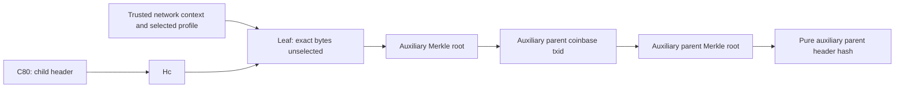

# AuxPoW design direction: owner review package

## 1. Decision requested, not a production specification

**v0.2.83 records a design-direction proposal.**
[Issue #101](https://github.com/andaluzcoin/andaluzcoin/issues/101) defines its scope
and is the authoritative external record of any later owner disposition.
No pre-agreed numbered v0.2.83 scope was found before that issue.
The frozen ALUZ input is **04954b692cb4fd26d0631369d0b0189fda402bb4**,
tree **d4d3d183abf7d893f4ce7daafab023580152e953**,
published as v0.2.82-auxpow-integration-readiness-research.

**PROPOSED preference: B, investigate an explicit domain-bound proof family
without using Namecoin's upper-version chain-ID namespace.**
Retain the pure 80-byte child identity as the proposed commitment starting point;
exclude the auxiliary proof from that identity and keep the dependency graph
acyclic. Investigate SHA256d parent work against the child's expected target,
with work credited once per accepted child. These are directions for a later
isolated specification, not approved ALUZ validation rules.

**Credible alternative A:** pursue intentional Namecoin-family compatibility,
including its header-ID/mode, leaf and proof-body semantics, after an explicit
ALUZ signaling/domain-policy review. It is not a drop-in change.

All **D01-D08 production gates remain OPEN**. All 21
[mainnet readiness gates](andaluzcoin-mainnet-readiness.md) remain unchecked;
public economic mainnet remains **NO-GO**.
No actual parent chain, format, leaf preimage, domain identifier, chain ID,
mode bit, strictness policy, numeric budget or activation is selected.
Production consensus, identity/network settings and descriptor-wallet-only
policy are unchanged by this documentation milestone.

## 2. Why this package advances the roadmap

The [readiness dossier, sections 7-8](andaluzcoin-auxpow-integration-readiness.md#7-unresolved-ownerreviewer-decisions)
maps the open decisions and requires specification choices before dependent
ALUZ implementation. The [candidate gates](andaluzcoin-auxpow-candidate-specification.md#14-decision-log-and-independent-acceptance-gates)
and [adversarial limits](andaluzcoin-auxpow-adversarial-resources.md#10-remaining-real-integration-gates)
still apply. This package prepares a recommendation, dissent and a reviewable
owner decision.

It does not add an ALUZ parser, a prototype consensus route, another toy driver
or duplicate inherited current-node tests. Source inspection is evidence about
the pinned implementations; no upstream verifier or historical proof corpus
was executed for this package. Existing research results retain their limits.

The source audit distinguishes **CURRENT ALUZ**, **PINNED NAMECOIN**,
**R0 RESEARCH**, **PROPOSED direction** and **LATER REQUIREMENT**.
A direction choice cannot silently promote an upstream rule or R0 constant
into ALUZ consensus.

## 3. Frozen source anchors

All external precedent below uses Namecoin revision
**942b14038f3ae704b6c2d50355de835d3ee92288**. These are code facts at that
revision, not claims about current miners, pool support or historical completeness.

| Anchor | Source and bounded observation |
| --- | --- |
| A01 | ALUZ [header/block serialization](https://github.com/andaluzcoin/andaluzcoin/blob/04954b692cb4fd26d0631369d0b0189fda402bb4/src/primitives/block.h#L26-L107) and [GetHash](https://github.com/andaluzcoin/andaluzcoin/blob/04954b692cb4fd26d0631369d0b0189fda402bb4/src/primitives/block.cpp#L15-L18): six-field, 80-byte child identity; full block adds transactions; no attached AuxPoW. |
| A02 | ALUZ [versionbits constants](https://github.com/andaluzcoin/andaluzcoin/blob/04954b692cb4fd26d0631369d0b0189fda402bb4/src/versionbits.h#L18-L34) and [version computation](https://github.com/andaluzcoin/andaluzcoin/blob/04954b692cb4fd26d0631369d0b0189fda402bb4/src/versionbits.cpp#L265-L284): current signaling namespace must be reviewed, not presumed free. |
| A03 | ALUZ [contextual header checks](https://github.com/andaluzcoin/andaluzcoin/blob/04954b692cb4fd26d0631369d0b0189fda402bb4/src/validation.cpp#L4112-L4152), [work arithmetic](https://github.com/andaluzcoin/andaluzcoin/blob/04954b692cb4fd26d0631369d0b0189fda402bb4/src/chain.cpp#L121-L134) and [index insertion](https://github.com/andaluzcoin/andaluzcoin/blob/04954b692cb4fd26d0631369d0b0189fda402bb4/src/node/blockstorage.cpp#L224-L255): contextual checks and target-work arithmetic are separate; index insertion deduplicates by child hash and derives its work from nBits. |
| N01 | Namecoin [pure header](https://github.com/namecoin/namecoin-core/blob/942b14038f3ae704b6c2d50355de835d3ee92288/src/primitives/pureheader.h#L21-L146): signed version division extracts chain ID; bit 8 marks AuxPoW; legacy means full version exactly 1. |
| N02 | Namecoin [header attachment](https://github.com/namecoin/namecoin-core/blob/942b14038f3ae704b6c2d50355de835d3ee92288/src/primitives/block.h#L29-L54) and [proof serializer](https://github.com/namecoin/namecoin-core/blob/942b14038f3ae704b6c2d50355de835d3ee92288/src/auxpow.h#L88-L114): flag-conditioned proof, witness-capable transaction and historical local fields. |
| N03 | Namecoin [linkage checker](https://github.com/namecoin/namecoin-core/blob/942b14038f3ae704b6c2d50355de835d3ee92288/src/auxpow.cpp#L41-L139) and [slot/Merkle helpers](https://github.com/namecoin/namecoin-core/blob/942b14038f3ae704b6c2d50355de835d3ee92288/src/auxpow.cpp#L143-L185): specific script/root/slot predicates, not a full parent validator. |
| N04 | Namecoin [header work route](https://github.com/namecoin/namecoin-core/blob/942b14038f3ae704b6c2d50355de835d3ee92288/src/validation.cpp#L1886-L1940), [numeric target path](https://github.com/namecoin/namecoin-core/blob/942b14038f3ae704b6c2d50355de835d3ee92288/src/pow.cpp#L153-L186) and [child context](https://github.com/namecoin/namecoin-core/blob/942b14038f3ae704b6c2d50355de835d3ee92288/src/validation.cpp#L4217-L4260): distinct layers. |
| N05 | Namecoin [transaction decoding](https://github.com/namecoin/namecoin-core/blob/942b14038f3ae704b6c2d50355de835d3ee92288/src/primitives/transaction.h#L184-L238), [txid computation](https://github.com/namecoin/namecoin-core/blob/942b14038f3ae704b6c2d50355de835d3ee92288/src/primitives/transaction.cpp#L69-L96) and [basic transaction checks](https://github.com/namecoin/namecoin-core/blob/942b14038f3ae704b6c2d50355de835d3ee92288/src/consensus/tx_check.cpp#L19-L59): decode, txid and transaction validity are different predicates. |

The [encoding/domain study](andaluzcoin-auxpow-chainid-domain-compatibility.md#5-signaling-flags-and-configured-versus-effective-ids)
traces the primary version/miner sources and signed arithmetic. The
[R0 specification](andaluzcoin-auxpow-proof-serialization-activation.md#2-immutable-precedent-and-differences)
defines the experimental comparator; it is intentionally not Namecoin wire format.
Actual function bodies and relevant branches were read, with separate
agent-assisted checks of the proposed direction and fixture provenance.
This is not an independent organizational security audit.

## 4. What “compatibility” would have to mean

Sharing SHA256d, a Merkle helper or slot arithmetic establishes none of the
following compatibility levels by itself:

| Level | Evidence required before making the claim |
| --- | --- |
| Header/identity | Same child hash preimage, signed version interpretation, flag and attachment routing under specified network/context rules. |
| Wire decoding | Exact transaction/witness forms, historical fields, branch/index encoding, accepted framing and reserialization behavior. |
| Proof predicates | Same leaf, commitment location/marker behavior, hash byte order, branch/slot and parent-child policy for a declared profile. |
| Work/context | Same applicable target, mode/flag consistency and contextual acceptance; no accidental fuzz-only PoW shortcut. |
| Transport/storage | Defined header/full/compact/RPC/disk/import/pruning views and proof availability, not just one decoded body. |
| Operational | Actual miner/pool job, submission and deployment compatibility, requiring separately authorized evidence. |

No such end-to-end compatibility or pool interoperability is established here.
B could reuse carefully specified body or Merkle components from A; a changed
domain-bound leaf would still change proof semantics. Conversely, copying a
proof serializer while retaining ALUZ's existing version logic is not full
Namecoin-family compatibility.

## 5. Alternative A: intentional Namecoin-family compatibility

**PROPOSED alternative, not selected:** use the pinned family as the basis of a
later exact compatibility specification. Its attraction is an existing code
reference and documented historical behavior rather than a new commitment
grammar. That can reduce invented mechanisms; it does not establish available
ALUZ-compatible pools or lower operational cost.

A must confront the whole contract: signed upper-version ID extraction,
AuxPoW flag, pure child identity, raw child-hash leaf, first-input scriptSig
commitment, historical markerless behavior, witness-capable proof transaction,
discarded legacy fields and child-target work routing. Namecoin's configured
strictness is a parameterized policy, not a universal safety conclusion.

The [signaling analysis](andaluzcoin-auxpow-chainid-domain-compatibility.md#5-signaling-flags-and-configured-versus-effective-ids)
shows the concrete overlap: current ALUZ's top versionbits pattern contributes
8192 to a nonnegative Namecoin-style extracted ID. This is an encoding example,
not an ALUZ ID proposal. Namecoin's pinned miner does not simply retain ALUZ's
current ComputeBlockVersion behavior. A would require intentional signaling,
domain and old/new-node policy design; no existing layout is assumed preserved.

**Dissent against B:** a new domain/leaf/profile family could add specification,
parser, tooling and independent-review burden without demonstrating a useful
operational benefit. Pool/relay/storage support and proof-availability migration
costs are unmeasured; existing support must not be assumed. Existing conventions
may be preferable if their drawbacks are understood and an explicit compatibility
goal justifies them.
A remains credible for that reason; it must not silently import Namecoin's
DAA, activation history, network parameters or every parent policy.

## 6. Preferred B: explicit domain binding outside the version-ID namespace

**PROPOSED investigation priority:** separate network-domain identity from
Namecoin's upper-version ID allocation and state the domain requirement
explicitly. Numeric chain IDs and P2P magic have separate roles. Investigate a
commitment that binds trusted node network context, its interpretation/profile
and the child.

The rationale is limited and source-backed: the
[domain matrix](andaluzcoin-auxpow-chainid-domain-compatibility.md#7-network-domain-and-replay-threat-matrix)
distinguishes slot labels, framing, genesis context and committed data.
Avoiding the upper-word ID interpretation addresses that particular namespace
overlap **only if Namecoin-style high-word ID equality or dispatch is not
quietly retained**. It does not solve unselected mode/flag/signaling rules.
It also does not resolve slot collisions, index/nonce predicates, parent-child
same-ID treatment or recursive-parent policy; those remain separate D02/D03
requirements. A network domain is not a substitute for those checks.

The trusted expected context must come from node/network policy; accepting an
unchecked domain label supplied by the prover would not authenticate it.
A later specification must define canonical typed framing, omitted/unknown
profile behavior, downgrade handling and checks at every applicable view.
No domain bytes, separator/tag, width, hash preimage, leaf algorithm, profile
number, slot discriminator or header-mode allocation is made by this paragraph.

**Reasons to prefer investigating B:** it makes domain and interpretation
requirements explicit while keeping the current pure child-hash starting point,
and avoids assuming that historical ID placement fits ALUZ signaling.
**Reasons not to select it yet:** no real verifier/corpus, threat-model result,
resource budget, interoperability or economic advantage has been demonstrated.
It is not asserted to be more secure, cheaper or production-ready than A.

## 7. Identity and the proposed acyclic commitment graph

Let C80 be the six-field child header, including the child's existing
transaction Merkle root and previous-child hash. Hc is its SHA256d identity.
For B, investigate the following **dependency graph, not an allocated encoding**:

The auxiliary parent coinbase, auxiliary parent roots/header and completed proof
are downstream. Do not feed them back into C80 or the leaf preimage.
The child's own transaction Merkle root is already part of C80 and is not the
downstream auxiliary parent root. Leaf and branch definitions remain unselected.

Excluding the proof avoids the direct commitment fixed-point problem only
with this acyclic dependency discipline. It is not sufficient merely to label
a hash “pure.” A proof-included final identity would need a distinct, explicitly
reviewed work-commitment/identity architecture; it is not a free cache fix.

This proposal does not mean future header messages, block serialization,
signaling, RPC or storage can remain unchanged. Dossier S01-S13 still require
review of every selected attachment view. A retained child identifier can name
different proof attachments; identity alone cannot authenticate new proof bytes.

## 8. Predicate ledger: decode is not acceptance

Read the rows as separate predicates, not an executable ALUZ acceptance order.
The named Namecoin functions establish only their own bounded checks.

| Predicate | PINNED NAMECOIN | R0 RESEARCH / decision consequence |
| --- | --- | --- |
| P01: representation | N02 conditionally decodes an attachment from the header flag; the proof includes a witness-capable transaction. | R0 has a detached AP79 container and opaque child header. It allocates no ALUZ flag or attachment view. |
| P02: legacy fields | N02 reads hashBlock and parent nIndex into local variables; they are not retained/checked. Serialization emits zero values. | R0 omits hashBlock and explicitly requires its parent index to be zero. Byte-exact decode/encode preservation cannot be presumed for Namecoin. |
| P03: witness/hash | N05 distinguishes witness decoding from nonwitness txid; N03 uses coinbaseTx GetHash for the parent Merkle branch. | R0 rejects witness encoding and hashes its exact nonwitness subset. Neither proves parent witness-commitment validity. |
| P04: parent transaction | N03 requires at least one input and reads the first input's scriptSig; it folds the parent branch at literal index zero. | Do not equate this isolated checker with IsCoinBase, full CheckTransaction, monetary, script or complete parent-block validity. R0's stricter one-null-input shape and unsigned amount fields establish none of those. |
| P05: commitment | N03 searches the reversed auxiliary root in scriptSig. If a marker exists, a second marker rejects and the marker must immediately precede the found root; markerless mode requires the first found root at byte offset at most 20. Size/nonce follow; extra bytes are not universally rejected. | R0 requires its distinct exact-length output-script commitment, unique marker and domain-bound synthetic leaf. It is not a compatible correction of N03. |
| P06: branch/slot | N03 caps auxiliary branch depth at 30, checks declared size against its height and index against getExpectedIndex. Parent branch has no dedicated depth cap in that checker. | R0 bounds both branches before iteration. Slot arithmetic alone neither authenticates a network nor establishes a total transport budget. |
| P07: mode/ID route | N04 applies the configured strict child-ID check only to nonlegacy headers; IsLegacy is full version 1. Proof/flag mismatches reject. An AuxPoW-flagged parent rejects independently of strictness; equal extracted parent/child IDs reject in N03 only when strict. | R0 decoders/linkage select none of these policies. Strictness and recursive-parent policy remain ALUZ decisions, not inherited defaults. |
| P08: numeric work | In the ordinary numeric path, N04 DeriveTarget rejects negative/zero/overflow/above-limit target; CheckProofOfWorkImpl compares the selected hash to that target. The header route compares auxiliary parent hash against CHILD nBits. | R0 performs no PoW. A parent inclusion proof, parent nBits or a smaller submitted hash must not create arbitrary child credit. |
| P09: child context | N04 separately checks expected bits, MTP/time and base-version rules, and disallows full-version-1 legacy blocks where AllowLegacyBlocks says so. | That rule is not equivalent to AuxPoW-only mode: correctly encoded direct work still has a route. R0's symbolic activation table is not node/context evidence. |
| P10: full parent network | N03/N04 do not establish full parent history, parent expected difficulty, transaction/scripts or parent witness validity. | A later specification must state exactly what parent evidence it validates. Neither alternative gets full parent-network consensus by implication. |

**Oracle caveat:** Namecoin's numeric CheckProofOfWork wrapper in N04 uses an
EnableFuzzDeterminism shortcut during fuzz testing. Future reference execution
claiming real numeric PoW must exclude that simplified path and record the
actual numeric result and expected verdict for each exact fixture, with the
build/configuration and applicable parameters. Execution or coverage of
DeriveTarget/CheckProofOfWorkImpl alone is insufficient.
No such oracle execution is claimed here. Linkage-check success is not numeric
work, contextual child acceptance, or full parent-network validation.

## 9. Work, failure, availability and cache consequences

**PROPOSED work direction:** retain SHA256d work against the child's
ancestry-derived expected target and once-only child credit. A03 supplies the
current arithmetic/context baseline; it is not a complete future AuxPoW route.
Parent-network difficulty is not a second child-work increment. Alternatives
for one accepted child must not add work again.

**LATER REQUIREMENTS**, traced to dossier V02-V10/V12-V16 and D03-D07:

- Distinguish unavailable proof, invalid attachment A1, invalid child context
  and a valid alternative A2. A2 must not inherit rejection solely from A1's
  shared child identifier; A2 cannot repair objectively invalid child bits.
- Identify the validated immutable proof bytes and relevant context for cache/
  concurrency reasoning; prevent a check/use swap. Do not select a cache key,
  lock strategy, status taxonomy, universal retry or permanent-failure policy here.
- Existing fChecked, validity levels and HAVE_DATA flags gain no proof meaning
  by inference. Header/data shortcuts and pruned availability need a design.
- A fixed child keeps its previous-child ancestry and derived height when the
  active tip changes. Runtime clock/data availability remain different inputs.
- Carry the selected evidence through admission/presync, full/compact relay,
  RPC proposal/submission and disk/index/import/reindex/pruning; one body parser
  cannot stand for all those routes.

These are conditional future obligations, not current ALUZ exploit claims.
B's domain binding would not cure a stale cache or transport allocation issue.
A's upstream precedent would not prove those integration obligations satisfied.

## 10. Fixture provenance and missing execution evidence

The bounded upstream tree/data/test-source review found no qualified historical
mined Namecoin AuxPoW corpus in the inspected paths. This is not a claim that
no such corpus exists elsewhere. No benchmark binary was downloaded.

| Inspected source | What it actually provides |
| --- | --- |
| [auxpow_tests.cpp:239-391](https://github.com/namecoin/namecoin-core/blob/942b14038f3ae704b6c2d50355de835d3ee92288/src/test/auxpow_tests.cpp#L239-L391), [418-509](https://github.com/namecoin/namecoin-core/blob/942b14038f3ae704b6c2d50355de835d3ee92288/src/test/auxpow_tests.cpp#L418-L509) | Builder-generated linkage scenarios and separately generated regtest work checks; not literal historical mined proof bytes or an executed oracle in this package. |
| [auxpow.py:13-67](https://github.com/namecoin/namecoin-core/blob/942b14038f3ae704b6c2d50355de835d3ee92288/test/functional/test_framework/auxpow.py#L13-L67) | Parameterized fake coinbase and unmined parent construction, then proof assembly. Its zero-output transaction illustrates why proof validity is not full parent transaction validity. |
| [auxpow_zerohash.py:65-105](https://github.com/namecoin/namecoin-core/blob/942b14038f3ae704b6c2d50355de835d3ee92288/test/functional/auxpow_zerohash.py#L65-L105) | Source assertions about generated regtest proofs accepting nonzero ignored fields and reserializing hashBlock as zero; inspected, not executed here. |
| [kernel/block_data.h](https://github.com/namecoin/namecoin-core/blob/942b14038f3ae704b6c2d50355de835d3ee92288/src/test/kernel/block_data.h#L9-L216), [mainnet_alt timestamps](https://github.com/namecoin/namecoin-core/blob/942b14038f3ae704b6c2d50355de835d3ee92288/test/functional/data/mainnet_alt.json#L1-L5) and [nonces](https://github.com/namecoin/namecoin-core/blob/942b14038f3ae704b6c2d50355de835d3ee92288/test/functional/data/mainnet_alt.json#L2020-L2024) | Regtest-labelled block literals and timestamp/nonce arrays respectively; not an established historical Namecoin AuxPoW proof corpus. |
| [benchmark consumer](https://github.com/namecoin/namecoin-core/blob/942b14038f3ae704b6c2d50355de835d3ee92288/src/bench/checkblock.cpp#L24-L49) | References a raw benchmark block, without establishing the Namecoin/AuxPoW provenance required here. Existence is not qualification. |

Future fixture work must record network, source revision, exact bytes/digests,
generation/acquisition method, hash order, applicable parameters and verdict
layer. Separate generated regtest, historical mined and malformed cases.
An existing upstream assertion is not an independently observed result.
R0/OpenSSL seals validate their declared synthetic facts, not either proposed
production family.

## 11. Finite next phase if the owner chooses a direction

The requested authorization is for **one later isolated specification phase**,
with the following finite deliverables, not open-ended prototype work:

1. Write a complete candidate contract for the chosen direction: identity/work
   commitment, domain/profile interpretation, all serialized views, transaction/
   witness and parent-proof predicates. Record alternatives rejected and why.
2. Define independent positive/negative fixture requirements and applicable
   reference verdicts by layer. Qualify available sources before promising a
   historical corpus; ensure numeric-work evidence cannot use fuzz determinism.
3. Analyze D04-D07 alongside that contract: per-route budgets, replacement/
   failure/cache assumptions, persistence and compatibility/recovery consequences.
   Specify future V-class acceptance cases without claiming them executed.
4. Return the exact candidate specification and evidence plan for separate review
   before any dependent real ALUZ parser or consensus/integration patch.

A direction answer permits proposing exact candidate bytes, tags and values
for separate review in that isolated specification. It allocates no official
value and approves no production format, parent chain, slot/branch rule, numeric
limit, mode/activation policy or code. Isolated third-party reference inspection
is not an ALUZ format choice.
If the selected direction proves incoherent or lacks needed evidence, return
the concrete conflict to the owner rather than silently switching families.

## 12. Owner decision form and release boundary

**Proposal-preparation status: PROPOSED / OPEN.**
Consult [issue #101](https://github.com/andaluzcoin/andaluzcoin/issues/101) for the
authoritative external record of any later owner disposition. Successful CI
supplies no critical design-direction approval.

| Owner field | Record when the concrete package/PR is reviewed |
| --- | --- |
| Direction | B for a later isolated specification; A instead; revision requested; or defer AuxPoW. No option is preselected as approved. |
| Reason/dissent | Why the chosen tradeoff is acceptable; unresolved concerns and rejected alternative. |
| Authorized scope | The bounded specification/evidence phase in section 11 only, or a narrower explicit scope. |
| Explicit exclusions | No dependent real ALUZ parser/consensus patch, production deployment, official values or activation approval. |
| Evidence | Immutable reviewed PR head, review links, owner identity/date and decision text. |

Suggested decision question: **Approve proposed B for the next isolated
specification phase, request A or a revision, or defer?**

A direction disposition does not close D01-D03's exact specification/evidence
requirements, D04-D08, or any launch gate. It is not permission to implement a
real ALUZ parser while those dependencies remain unresolved. Pool participation,
live mining, deployment, outreach and operational evidence remain unauthorized.

Issue #101 requires a concrete draft PR, relevant validation/technical review,
successful exact-head CI and the owner's explicit critical direction disposition
before merge or research tagging. The owner can review the ready package while
CI runs; a direction decision does not waive CI. Standing approval for routine
research releases and green CI do not supply that disposition. After an allowed
regular merge, successful exact-merge master CI is required before the verified
annotated research tag and final report/closure under the established workflow.

This documentation package changes no production rule and claims no fresh
runtime, upstream-oracle, historical-proof, interoperability or security pass.
The research acceptance checklist is distinct from the **eight OPEN production
decision gates** and **21 unchecked mainnet gates / NO-GO**.
